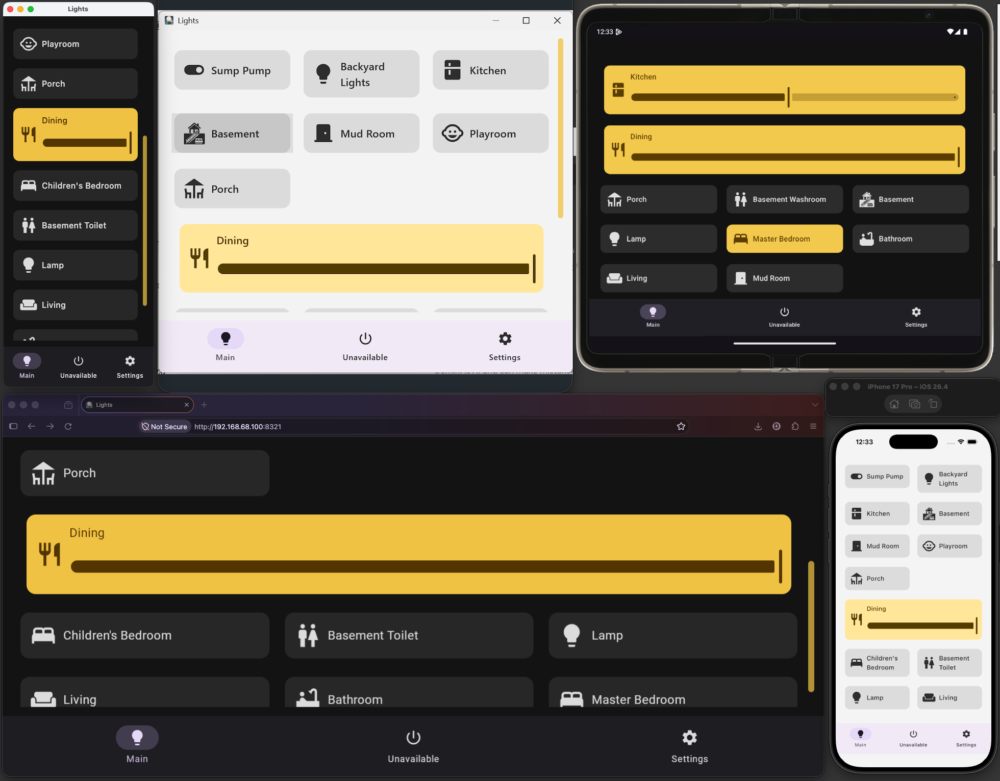

# Lights

A cross-platform Home Assistant remote built with Kotlin and Compose Multiplatform. It started as an
Android app and now runs natively on **Android, iOS, macOS, Windows and the web**. All platforms share the
same core UI and business logic.

My family uses it every day. It shows the state of the house at a glance, turns lights and switches on
and off, dims lights, and on Android takes voice commands. The web version is served from a home NAS
through a small gateway. The gateway stores the Home Assistant token server-side. The browser submits it
during initial setup, but the gateway never returns it to the client or stores it in browser storage.



*One shared Kotlin UI on macOS, Windows, an Android foldable, a browser (served from the NAS) and an iPhone.*

## Engineering highlights

- **One codebase, five platforms.** The Compose UI and business logic live in a shared Kotlin
  Multiplatform module. Each platform adds a thin layer of about 300–1,400 lines.
- **An incremental migration from Android.** There was no big-bang rewrite. The Android app kept working
  after every commit, and a visual regression test was in place before the UI moved.
- **Platform code behind explicit interfaces.** Storage, networking, permissions, camera, voice and
  logging go through `PlatformBridge`. Shared code never touches a platform API.
- **Credentials stay on the server.** The web client talks to a Ktor gateway on the NAS. The gateway holds
  the HA token and allows only the few HA calls the app needs.

## What it does

- **Status at a glance.** Each light or switch is a large button. Lights that are on turn yellow, and
  dimmable lights that are on get a full-width brightness slider.
- **Live state.** The app polls Home Assistant while it is on screen, and again right after each command,
  because HA can be slow to apply changes.
- **Voice control (Android).** A Porcupine wake word, then commands like *"turn on the kitchen"* or
  *"dim the dining"*. It runs in a foreground service and starts again after a reboot.
- **Easy setup.** Enter the HA URL and token by hand, or scan a QR code shown by a device that is already
  set up (Android). There's also a demo mode with bundled data.
- **Accessible.** It adapts to large system fonts, down to a single column if needed. It handles split
  screen and foldables, has dark and light themes, and translates the UI on the device with ML Kit
  (Android).

| Platform | Status | Notes |
|---|---|---|
| Android | Daily use | All features: voice, QR scanning and setup, translation |
| Web (NAS) | Daily use | Any browser on the home network; the token stays on the gateway |
| macOS / Windows | Works | DMG, MSI and EXE installers |
| iOS / iPadOS | Works | Native Compose Multiplatform. Voice and QR scanning are not ported yet |

## How it got here

**An Android app.** It began as an MVP: a Jetpack Compose list of devices, a foreground
service listening for a wake word, and a command parser. Daily use then shaped it:

- reboot handling and better command parsing
- grid layouts for split screen, foldables and large fonts
- a repository with a mock API, then demo mode
- configurable polling
- QR provisioning: one device shows a QR code with a deep link, and the next one scans it

**Getting ready for multiplatform, while still Android-only.** I migrated in small steps. Each commit
removed one Android dependency from the code that would later be shared, and kept the app working.

- **A safety net first.** A pixel-comparison screenshot test of the main screen.
- **Platform abstractions.** `ViewModel`s became plain `StateFlow` state holders. Networking moved from
  OkHttp + Gson to Ktor + kotlinx.serialization. Everything that differs between platforms moved behind
  the `PlatformBridge` interfaces: preferences, logging, permissions, dispatchers, translation, voice, the
  QR scanner and the HTTP engine.
- **A repository rewrite that fixed real bugs.** `HomeAssistantRepository` became the single owner of
  device state and of all HA requests, with a suspend API instead of listeners. All state now lives on one
  dispatcher, which fixed races between the polling loop and UI commands.
- **Removing JVM-only libraries.** ZXing was replaced by a small QR encoder in plain Kotlin, and tests use
  ZXing to check that its output decodes. Asset loading and permission checks became `suspend`, because
  they are asynchronous in a browser.

**The move.** Thanks to that groundwork, moving the code to the `:shared` module was a pure move with no
code changes. A second commit moved the whole UI to Compose Multiplatform. After that, `:app` contained
only the Android platform layer.

**New platforms.** Each new target only needed its platform layer.

- **Desktop (macOS, Windows).**
  - jpackage installers.
  - It builds without the Android SDK.
  - Owner-only settings file.
  - App size cut by a third, by bundling only the icons the app uses.
- **Web (Kotlin/Wasm) and the NAS gateway.** This needed one new abstraction, `IHaEndpoint`: native apps
  call HA directly with a token, and the web app calls its own origin.
- **iOS.**
  - NSUserDefaults for settings and the Darwin (NSURLSession) HTTP engine.
  - Export through the share sheet.
  - A minimal SwiftUI host, with the Xcode project generated by XcodeGen.

Going from Android-only to all five platforms took about two weeks, and every step was a working build.

## Architecture

```
:shared            commonMain: all UI (Compose Multiplatform), HA client + repository,
                   voice command parser, QR encoder, settings, onboarding
                   skikoMain: desktop + web UI bits (scrollbars)
                   iosMain:   iOS platform layer + MainViewController
:app               Android platform layer: services, CameraX, ML Kit, permissions
:desktopApp        Desktop platform layer + window (Compose Desktop)
:webApp            Web platform layer (Kotlin/Wasm) + gateway endpoint
:gateway           Ktor server for the NAS: serves :webApp, holds the HA token
iosApp/            SwiftUI host for the Shared framework
```

- **`PlatformBridge`** holds the platform services. Each app fills it in once at startup, and shared code
  only uses the interfaces.
- **`LocalPlatformUi`** gives the shared UI the few UI pieces that differ per platform: the back handler,
  the QR scanner with its camera preview, and scrollbars.
- **`IHaEndpoint`** decides how a request reaches Home Assistant: directly with a token (native), or
  through the gateway (web).

Approximate lines of hand-written Kotlin (main sources only, no tests or generated code):

| Code | Lines |
|---|---|
| Shared (`commonMain` + `skikoMain`) | ~6,400 |
| Android platform layer (voice service, CameraX, ML Kit) | ~1,400 |
| Web platform layer | ~400 |
| iOS platform layer | ~300 |
| Desktop platform layer | ~300 |
| NAS gateway | ~250 |

## Web gateway and security

The `:gateway` server (Ktor, in Docker on a Synology NAS) does these things:

- **Serves the web app.** Its API calls go to the same origin, so there's no CORS setup and the browser
  never holds the token.
- **Forwards only the HA calls the app uses.** Everything else is blocked.
- **Keeps the token on the server.**
  - It is stored in `data/ha.properties` with mode 600.
  - It is masked in logs and never returned in a response.
- **First-run setup is accepted only while the gateway is unconfigured.**
  - Until then, anyone on the LAN who opens the page can set it up, so do the setup right after
    installing.
  - The URL and token are checked against HA before they are saved.
  - Reconfiguring means deleting the file on the NAS and restarting the gateway.

It is meant for the **home network only**: no port forwarding, reverse proxy or QuickConnect. Anyone on
the LAN who can open the page can switch lights. Details are in [docs/nas.md](docs/nas.md#security-notes).

## Lessons learned

- **KMP and Compose Multiplatform worked well for this project.** I was impressed. The same UI code runs on
  five platforms, and adding iOS was mostly a matter of filling in `PlatformBridge`.
- **Shared UI doesn't mean identical UX.** Touch platforms hide scrollbars, but on desktop and web their
  absence feels broken. I added visible scrollbars there, including a span-aware adapter because the
  stock grid scrollbar mis-measures full-width items. Back navigation also differs: Android has a system
  back button, while desktop and iOS rely on in-app buttons.
- **The web is its own world.** Serving the app and the API from one origin through the gateway removed
  CORS from the picture, and the dev server mimics that. It gave me a new appreciation for what web
  developers deal with when deploying.
- **Each runtime has its own interop rules.**
  - In Kotlin/Wasm, `js()` must be the entire body of a top-level function.
  - An init-order cycle that the JVM tolerated caused a crash on Wasm.
  - In Kotlin/Native, a Kotlin `String` passed through C varargs (as in `NSLog`) is not an `NSString`.
- **Test every platform's code paths.** Shared code covers most of the app, but platform-specific
  branches like the web's gateway setup only show their bugs on that platform.

## Build & run

| Platform | Module | Guide |
|---|---|---|
| Android | `:app` | [docs/android.md](docs/android.md) |
| iOS / iPadOS | `iosApp/` + `:shared` | [docs/ios.md](docs/ios.md) |
| macOS, Windows | `:desktopApp` | [docs/desktop.md](docs/desktop.md) |
| Web, development | `:webApp` | [docs/web.md](docs/web.md) |
| Web on a NAS (Docker) | `:webApp` + `:gateway` | [docs/nas.md](docs/nas.md) |

Prerequisites, and where each app keeps the HA URL and token, are in [docs/README.md](docs/README.md).
Secrets are entered at runtime and never committed.

**Stack:** Kotlin 2.3, Compose Multiplatform 1.11 (Material 3), coroutines and `StateFlow`, Ktor (client
and server), kotlinx.serialization, CameraX, ML Kit, Porcupine, Docker.

## License

© 2026 Doron Yakovlev Golani. All rights reserved.

The source is public so it can be read and reviewed, for example as a work sample. No license is
granted: copying, modifying, distributing or using this code requires the author's written permission.
